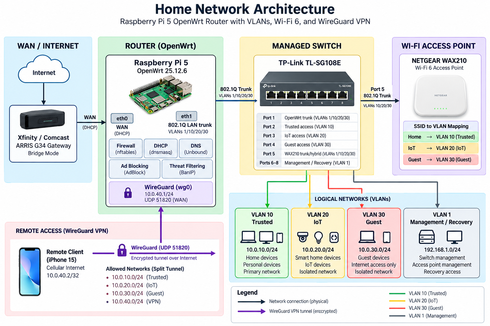

# Raspberry Pi 5 OpenWrt Router

A custom OpenWrt router built around a Raspberry Pi 5 with VLAN network segmentation, DNS-over-TLS, DNSSEC, network-wide ad blocking, IP threat filtering, and WireGuard remote access.

## Project Overview

The goal of this project was to build and deploy a configurable home router using OpenWrt and dedicated networking hardware rather than relying entirely on an ISP-provided gateway.

The Raspberry Pi 5 handles routing, firewalling, DHCP, DNS, VPN access, and security services. A TP-Link managed switch distributes the VLANs to wired devices and a NETGEAR Wi-Fi 6 access point provides separate wireless networks.

The completed system included:

- Raspberry Pi 5 running OpenWrt from NVMe storage
- Dedicated Gigabit Ethernet WAN and LAN interfaces
- 802.1Q VLAN network segmentation
- Separate Trusted, IoT, Guest, and VPN networks
- Firewall isolation between network segments
- Wi-Fi 6 with SSID-to-VLAN mapping
- Unbound with DNSSEC validation and DNS-over-TLS to Quad9
- Network-wide ad and tracker blocking
- BanIP threat filtering
- WireGuard remote-access VPN
- Dynamic DNS
- Network traffic monitoring
- Configuration backup and recovery

## Network Architecture

During deployment, the network was configured as:

**Internet → ARRIS G34 (bridge mode) → Raspberry Pi 5 → TP-Link TL-SG108E → wired devices / NETGEAR WAX210**

The Pi's built-in Gigabit Ethernet interface was used for WAN. A USB 3.0 Gigabit Ethernet adapter was used as the LAN interface and carried the VLAN trunk between the Pi and managed switch.

The network was divided into the following segments:

| Network | VLAN | Subnet | Purpose |
|---|---:|---|---|
| Trusted | 10 | `10.0.10.0/24` | Personal computers, phones, and trusted devices |
| IoT | 20 | `10.0.20.0/24` | Smart-home and embedded devices |
| Guest | 30 | `10.0.30.0/24` | Guest Internet access |
| VPN | — | `10.0.40.0/24` | WireGuard remote clients |
| Management / Recovery | 1 | `192.168.1.0/24` | Infrastructure management and recovery |

IoT and Guest devices were allowed Internet access and required router services such as DHCP and DNS, while access to the Trusted network was restricted. Guest Wi-Fi also used client isolation to prevent guest devices from communicating directly with each other.

More detail is available in [`docs/architecture.md`](docs/architecture.md) and [`docs/network-design.md`](docs/network-design.md).

## DNS and Security

Client DNS requests were handled by dnsmasq and forwarded locally to Unbound. Unbound then forwarded requests to Quad9 using DNS-over-TLS on port 853.

DNSSEC validation was enabled and tested using an intentionally invalid DNSSEC domain. The resolver correctly returned `SERVFAIL` for the invalid domain while normal DNS requests continued to resolve.

AdBlock provided network-wide domain filtering, while BanIP was used for IP-based threat filtering. At final testing, the AdBlock configuration contained approximately 334,000 blocked domains.

The OpenWrt firewall used REJECT as the default policy for input and forwarding, with rules added only for the traffic required by each network. LuCI and SSH were not exposed to the WAN.

Additional security details are documented in [`docs/security.md`](docs/security.md).

## WireGuard VPN

WireGuard was configured directly on the OpenWrt router using the `10.0.40.0/24` VPN subnet. Dynamic DNS was used so the router could still be reached when the residential public IP address changed.

Remote access was tested from an iPhone 15 using cellular data. The test confirmed successful WireGuard handshakes, remote access to the OpenWrt management interface, DNS resolution, and Internet connectivity.

Private keys, authentication tokens, Wi-Fi credentials, and other secrets are intentionally excluded from this repository. A sanitized configuration example is available in [`configs/wireguard.example`](configs/wireguard.example).

## Hardware

| Component | Model |
|---|---|
| Router | Raspberry Pi 5 Model B |
| Primary Storage | WD Green SN350 250 GB NVMe SSD |
| NVMe Adapter | Pimoroni NVMe Base |
| Enclosure | Pimoroni NVMe Base Case |
| Cooling | Raspberry Pi Active Cooler |
| Power Supply | Official Raspberry Pi 27 W USB-C PSU |
| WAN Interface | Raspberry Pi integrated Gigabit Ethernet |
| LAN Interface | Cable Matters USB 3.0 Gigabit Ethernet adapter |
| Managed Switch | TP-Link TL-SG108E |
| Wireless Access Point | NETGEAR WAX210 |
| ISP Gateway | ARRIS G34 |

OpenWrt was installed on the NVMe SSD, with the microSD card retained as a recovery option.

Detailed hardware information is available in [`docs/hardware.md`](docs/hardware.md).

## Software

The final router ran **OpenWrt 25.12.6** on the `bcm27xx/bcm2712` target.

Major packages and services included:

- nftables
- dnsmasq
- Unbound
- AdBlock
- BanIP
- WireGuard
- DDNS
- vnStat
- LuCI

## Testing and Results

The completed system was tested for routing, network isolation, DNS operation, VPN connectivity, reboot persistence, and wired/wireless performance.

Testing included:

- WAN DHCP and IPv4 Internet connectivity
- DHCP assignment on each VLAN
- Inter-VLAN firewall isolation
- IoT and Guest network isolation
- Guest wireless client isolation
- DNSSEC validation
- DNS-over-TLS
- Ad blocking and BanIP operation
- WireGuard access over an external cellular connection
- Dynamic DNS
- Firewall exposure
- Reboot persistence
- Ethernet link negotiation
- Wi-Fi throughput
- CPU, memory, and temperature monitoring

Both Ethernet interfaces negotiated at 1 Gbit/s. During final testing, the Pi remained effectively idle under normal routing workloads and ran at approximately 41.9 °C, leaving substantial CPU and memory headroom.

A Wi-Fi 6 client located near the WAX210 achieved approximately **533 Mbps download, 180 Mbps upload, and 13 ms latency**. The client was connected over 5 GHz 802.11ax with approximately 1.2 Gbit/s negotiated PHY rates.

Full validation results are documented in [`docs/testing.md`](docs/testing.md).

## ISP Bridge Mode Troubleshooting

One of the main problems encountered during deployment occurred when the ARRIS G34 was switched into bridge mode. The Pi initially failed to receive an IPv4 DHCP lease even though the physical Ethernet connection was working.

Packet capture showed DHCP Discover packets leaving the Pi without any DHCP Offer being returned. A laptop connected directly to the bridged modem showed the same behavior, which helped rule out the Pi's OpenWrt configuration as the only possible cause.

The issue was resolved by cloning the G34's WAN MAC address onto the Pi's WAN interface and performing a full modem power cycle. After that, OpenWrt received a public IPv4 lease from Comcast and the Pi operated normally as the Internet-facing router.

Additional debugging information and lessons learned are documented in [`docs/troubleshooting.md`](docs/troubleshooting.md).

## Deployment Result

The router itself worked as intended during deployment. VLAN segmentation, firewall isolation, encrypted DNS, DNSSEC, ad blocking, threat filtering, WireGuard, and Gigabit Ethernet routing were all successfully tested.

The main limitation ended up being wireless coverage. The single WAX210 provided strong performance nearby, but throughput dropped below roughly 50 Mbps in parts of the multi-story house. The existing household network provided better whole-home coverage, so the OpenWrt system was removed from active household deployment after testing.

This did not indicate a routing or Raspberry Pi performance problem. It showed that the network needed either better AP placement or multiple access points with wired backhaul for a house of that size. The completed configuration was preserved for future use, particularly for deployment in a smaller apartment.

## Repository Structure

### Documentation

- [`docs/architecture.md`](docs/architecture.md) — System architecture, interfaces, VLANs, switching, wireless, DNS, and remote access
- [`docs/hardware.md`](docs/hardware.md) — Raspberry Pi, NVMe storage, Ethernet adapters, switch, access point, cooling, and power
- [`docs/network-design.md`](docs/network-design.md) — VLAN addressing, DHCP, switch configuration, routing, and wireless VLAN mapping
- [`docs/security.md`](docs/security.md) — Firewall policy, DNS security, AdBlock, BanIP, WireGuard, and configuration sanitization
- [`docs/testing.md`](docs/testing.md) — Functional validation, performance measurements, reboot testing, and deployment results
- [`docs/troubleshooting.md`](docs/troubleshooting.md) — Ethernet compatibility, VLAN recovery, ISP bridge-mode debugging, and wireless coverage analysis

### Sanitized Configuration Examples

- [`configs/network.example`](configs/network.example) — OpenWrt interfaces, bridge, VLANs, and WAN configuration
- [`configs/firewall.example`](configs/firewall.example) — Firewall zones, forwarding, DHCP/DNS access rules, and WireGuard WAN rule
- [`configs/dhcp.example`](configs/dhcp.example) — dnsmasq and DHCP scopes
- [`configs/unbound.example`](configs/unbound.example) — Unbound, DNSSEC, and DNS-over-TLS architecture
- [`configs/wireguard.example`](configs/wireguard.example) — Sanitized WireGuard server and client configuration

### Diagram

- [`images/architecture-diagram.png`](images/architecture-diagram.png) — Network architecture diagram

Configuration files included in the repository are sanitized examples and do not contain production credentials or cryptographic secrets.

## Future Work

- Add native IPv6 routing and firewall policies
- Deploy multiple access points with wired backhaul for larger environments
- Expand traffic monitoring and visualization
- Automate configuration backups
- Perform additional routing and VPN throughput benchmarks

## Skills Covered

- Raspberry Pi 5 system integration and NVMe boot configuration
- OpenWrt installation, configuration, and administration
- IPv4 routing, subnetting, and DHCP
- IEEE 802.1Q VLAN design and network segmentation
- Managed Ethernet switch configuration
- Firewall policy design and inter-VLAN isolation
- Wi-Fi 6 deployment and SSID-to-VLAN mapping
- DNS configuration with dnsmasq and Unbound
- DNSSEC validation and DNS-over-TLS
- Network-wide ad and tracker blocking
- IP-based threat filtering with BanIP
- WireGuard VPN configuration and remote-access testing
- Dynamic DNS
- Linux networking and command-line administration
- Packet capture and DHCP troubleshooting
- ISP gateway and bridge-mode integration
- Network security hardening
- Wired and wireless performance testing
- CPU, memory, and thermal monitoring
- Configuration backup and recovery
- RF coverage evaluation and network deployment
